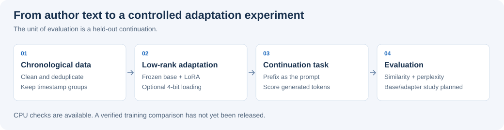

# Parameter-Efficient Language Model Adaptation

[](https://github.com/jeck5iv/PersonalLLM-LoRA-Style-Adaptation/actions/workflows/checks.yml)

**[Research notes](docs/research.md) · [Evaluation protocol](docs/evaluation-protocol.md) · [Configurations](configs/) · [CPU checks](tests/)**

Can a low-rank adapter learn an author's writing patterns from a limited collection of posts, while preserving useful language-model behaviour?

I formulated the experiment as **conditional language modelling with a low-rank parameter update**, using chronological data separation and held-out continuation evaluation. The implementation uses PyTorch, Hugging Face and PEFT/LoRA. Model, quantisation, adapter and training settings are separated so that experiments share the same pipeline. The repository includes Qwen 1.5B and 7B configurations, Mistral 7B and optional FP4/NF4 loading.



## Research design

| Component | Design choice | Why it matters |
| --- | --- | --- |
| Data | Preserve punctuation, remove exact cleaned duplicates, split by timestamp | Retain stylistic features and evaluate later writing |
| Adaptation | Freeze the base model; learn LoRA updates to attention projections | Study adaptation with a smaller trainable parameter set |
| Training | Causal next-token loss with padding labels masked | Avoid learning from artificial padding tokens |
| Evaluation | Give a held-out prefix and score only its generated continuation | Keep prompt tokens out of generation metrics |
| Diagnostics | BERTScore, perplexity, BLEU/ROUGE-L and repetition | Examine different aspects of continuation behaviour |

For a projection matrix, LoRA parameterises the update as $\Delta W=(\alpha/r)BA$, where the adapter rank $r$ is much smaller than the projection dimensions. Optional 4-bit loading reduces base-weight storage; actual memory use depends on hardware, checkpoint and training settings.

## Evidence status

The public artifact contains the implementation, experiment configurations and CPU tests. It contains **no verified base-versus-adapter results table**, private posts or trained checkpoints. GPU training and generation quality have not been rerun for this release.

Text overlap and semantic similarity do not by themselves establish style transfer. The [evaluation protocol](docs/evaluation-protocol.md) defines the matched baseline, frozen prompts, multi-seed comparison and blinded style review needed for that claim.

## Try the data pipeline

Python 3.11 or 3.12. This example runs on a CPU without model downloads or credentials:

```bash
python -m venv .venv
source .venv/bin/activate
python -m pip install -r requirements-checks.txt
python -m scripts.prepare_data \
  --input examples/posts.csv --output /tmp/style-data --min-chars 20
python -m unittest discover -s tests
```

The example posts are synthetic. For other data, provide a CSV with `date` and `text` columns and permission to process its contents. Preparation writes cleaned text and timestamps, removes URLs and handles, and keeps equal timestamps in one split. Basic redaction is not full anonymisation.

## Train an adapter

The following is the configured training path, which requires a suitable GPU environment:

```bash
python -m pip install -r requirements.txt
python -m scripts.prepare_data --input /path/to/consented-posts.csv --output data
python main.py --model configs/models_configs/Qwen2.5-1.5B-Instruct.json
```

Select alternative settings with `--lora` and `--train`; add `--quant configs/quantisation_configs/quant_nf4.json` for a 4-bit run. The first run downloads the selected checkpoint from Hugging Face subject to its access and licence terms.

Adapter weights go to `checkpoints/`; evaluation writes aggregate metrics to the ignored `metrics_log.csv`. Generation uses greedy decoding. The default language is Russian, matching the original experiment. `requirements-legacy.txt` preserves the old environment snapshot.

## Code map

| Path | Responsibility |
| --- | --- |
| [Preparation](scripts/prepare_data.py) | Cleaning, deduplication and chronological separation |
| [Fine-tuning](scripts/finetune.py) | Adapter training and padding masks |
| [Evaluation](scripts/metrics.py) | Token-based continuation slicing and metrics |
| [Tests](tests/test_pipeline.py) | Data boundaries, token handling and configuration paths |
| [Research notes](docs/research.md) | Experimental motivation, corrections and remaining questions |

Use only authorised text and review identifying details before training. Do not publish adapters that may memorise private material. The legacy `main_gpt.py` wrapper is incomplete in the public snapshot and is outside the supported path. Local training and evaluation do not send posts to an external inference API; local credentials, sessions and weights remain ignored. Removing a secret from the current tree does not remove it from Git history.
